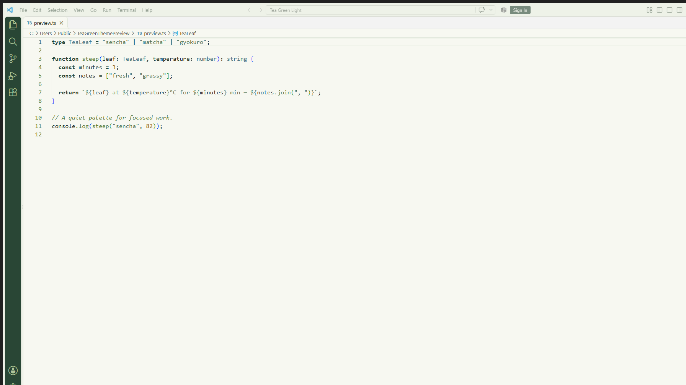
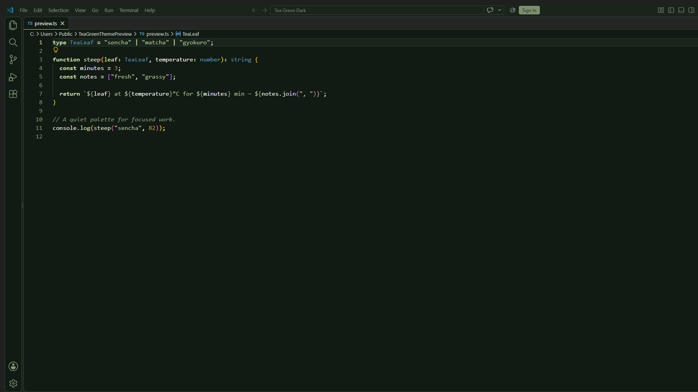

# Tea Green Theme — Tema de color claro y oscuro para Visual Studio Code

> Tema de color para Visual Studio Code con variantes clara y oscura. Tea Green combina tonos crema, matcha y verde bosque para una experiencia tranquila y legible.


## Capturas

| Tea Green Light | Tea Green Dark |
|---|---|
|  |  |

Quien escribe código en Visual Studio Code elige entre Tea Green Light o Tea Green Dark para editar archivos de texto, configuración y código fuente.

## Tabla de contenidos

- [Descripción](#descripción)
- [Descarga](#descarga)
- [Características principales](#características-principales)
- [Stack tecnológico](#stack-tecnológico)
- [Arquitectura](#arquitectura)
- [Instalación y uso](#instalación-y-uso)
- [Requisitos del sistema](#requisitos-del-sistema)
- [Formato de los archivos de tema](#formato-de-los-archivos-de-tema)
- [Buenas prácticas de uso](#buenas-prácticas-de-uso)
- [Notas de publicación](#notas-de-publicación)
- [Roadmap](#roadmap)
- [Licencia](#licencia)
- [Autor](#autor)

## Descripción

Tea Green Theme es una extensión de Visual Studio Code que provee dos variantes de color: una clara (`Tea Green Light`, `uiTheme: vs`) y una oscura (`Tea Green Dark`, `uiTheme: vs-dark`). Los archivos de tema viven en `themes/tea-green-light.json` y `themes/tea-green-dark.json`, respectivamente.

La idea de fondo es ofrecer una paleta inspirada en hojas de té verde, matcha, verde salvia y tonos crema, evitando verdes neón, fondos negros puros y excesos de glassmorphism. El tema claro usa fondo `#F7F8F1`, superficies `#FFFFFF` y `#EEF2E8`, texto principal `#1E2A21` y bordes `#D9E2D5`. El tema oscuro usa fondo `#111A13`, superficie `#19241B`, texto principal `#F1F5EB` y bordes `#334436`.

Ambos archivos definen tres secciones: `colors` (interfaz de usuario: editor, sidebar, pestañas, terminal, botones, Git), `tokenColors` (sintaxis del editor mediante scopes de TextMate) y `semanticTokenColors` (tokens provistos por servidores de lenguaje LSP: clase, función, variable, parámetro, etc.). El resaltado semántico se activa cuando el servidor de lenguaje correspondiente lo proporciona.

## Descarga

| Capa | URL |
|---|---|
| Repositorio | https://github.com/TeVerde29/tea-green-theme.git |
| Página del proyecto | https://github.com/TeVerde29/tea-green-theme#readme |
| Reportar errores | https://github.com/TeVerde29/tea-green-theme/issues |
| Paquete local | `tea-green-theme-1.0.2.vsix` |

## Características principales

- **Dos variantes de tema:** `Tea Green Light` para entornos iluminados y `Tea Green Dark` para poca luz, declaradas en `package.json` bajo `contributes.themes`.
- **Colores de interfaz coherentes:** fondo, superficie, texto, bordes, foco y estados de éxito, advertencia, error e información comparten tokens entre variantes.
- **Colores de sintaxis:** `tokenColors` asigna colores a comentarios, cadenas, números, palabras clave, funciones, clases, variables, propiedades, etiquetas y atributos mediante scopes de TextMate.
- **Resaltado semántico:** `semanticTokenColors` cubre namespace, type, class, enum, interface, struct, typeParameter, parameter, variable, property, enumMember, event, function, method, macro, keyword, modifier, comment, string, number, regexp y operator.
- **Decoraciones de Git:** colores para recursos added, modified, deleted y untracked en el explorador de archivos.
- **Colores de terminal:** 16 colores ANSI (normal y brillante) definidos por tema.

## Stack tecnológico

| Capa | Tecnología | Función |
|---|---|---|
| Extensión | Visual Studio Code Theme API | Registro de temas de color |
| Motor de temas | JSON (VS Code Color Theme) | Definición de `colors`, `tokenColors` y `semanticTokenColors` |
| Motor mínimo | VS Code `^1.70.0` | Versión mínima del motor declarada en `engines` |
| Icono | `images/ricra-tea-green.png` | Imagen de la extensión en el Marketplace |

## Arquitectura

```
tea-green-theme/
├── package.json                 # Manifiesto de la extensión (nombre, versión, publisher, temas)
├── README.md                    # Documentación
├── LICENSE                      # Licencia MIT
├── images/
│   └── ricra-tea-green.png      # Icono de la extensión
├── screenshots/
│   ├── tea-green-light.png      # Vista previa del tema claro
│   └── tea-green-dark.png       # Vista previa del tema oscuro
├── themes/
│   ├── tea-green-light.json     # Tema claro (uiTheme: vs)
│   └── tea-green-dark.json      # Tema oscuro (uiTheme: vs-dark)
└── tea-green-theme-1.0.2.vsix   # Paquete empaquetado de la versión 1.0.2
```

- **Temas declarados en `package.json`:** `contributes.themes` apunta a `themes/tea-green-light.json` (`uiTheme: "vs"`) y `themes/tea-green-dark.json` (`uiTheme: "vs-dark"`).
- **Sin servidor propio:** es un tema de color estático; no hay backend, base de datos ni API.
- **Instalado vs desarrollo:** en desarrollo se editan los JSON directamente; en instalado se distribuye el `.vsix` generado con `vsce package`.

## Instalación y uso

1. Abre la paleta de comandos con `Ctrl+Shift+P` (`Cmd+Shift+P` en macOS).
2. Ejecuta **Preferences: Color Theme**.
3. Elige **Tea Green Light** o **Tea Green Dark**.

### Desde el Marketplace

Busca **Tea Green Theme** en la vista Extensions de VS Code, o instálalo desde terminal:

```sh
code --install-extension ricra.tea-green-theme
```

### Desde un archivo VSIX

Descarga el `.vsix` de la versión que quieras instalar y ejecuta:

```sh
code --install-extension ricra.tea-green-theme-1.0.2.vsix
```

### Flujo básico de uso

1. Abre un archivo de código (por ejemplo `package.json` o un archivo de código fuente).
2. Observa los colores aplicados: comentarios en verde, cadenas en matcha, palabras clave en verde bosque (claro) o matcha (oscuro), y variables según el tema activo.
3. Cambia de tema desde la paleta de comandos si necesitas pasar de modo claro a oscuro.

## Requisitos del sistema

| Componente | Requisito mínimo |
|---|---|
| Editor | Visual Studio Code `^1.70.0` |
| Sistema operativo | Windows, macOS o Linux (soportado por VS Code) |

## Formato de los archivos de tema

Cada tema es un archivo JSON con esta estructura:

```json
{
  "name": "Tea Green Light",
  "type": "light",
  "colors": {
    "editor.background": "#F7F8F1",
    "editor.foreground": "#1E2A21"
  },
  "tokenColors": [
    {
      "scope": ["comment"],
      "settings": { "foreground": "#294635", "fontStyle": "italic" }
    }
  ],
  "semanticTokenColors": {
    "function": "#567B3B",
    "string": "#4F7256"
  }
}
```

- `colors`: colorea la interfaz de VS Code (editor, sidebar, pestañas, terminal, botones, Git).
- `tokenColors`: colorea la sintaxis del editor según scopes de TextMate.
- `semanticTokenColors`: colorea según tokens semánticos de servidores de lenguaje (LSP).

## Buenas prácticas de uso

- Usa **Tea Green Light** en entornos con buena iluminación para reducir fatiga visual.
- Usa **Tea Green Dark** en entornos con poca luz; su fondo `#111A13` no es negro puro, lo que evita halos alrededor del texto.
- No edites los JSON del tema instalado directamente; modifica los archivos fuente y vuelve a empaquetar con `npx @vscode/vsce package`.
- El tema no controla tipografía; configura `editor.fontFamily` en los ajustes de VS Code con una fuente monoespaciada instalada en tu sistema si deseas personalizarla.

## Notas de publicación

1. Incrementa `version` en `package.json` (actual: `1.0.2`).
2. Ejecuta `npx @vscode/vsce login ricra` para autenticar el publicador.
3. Ejecuta `npx @vscode/vsce publish` para subir al Marketplace.
4. Para empaquetar localmente sin publicar: `npx @vscode/vsce package`.

## Roadmap

- Revisar contraste de scopes de sintaxis adicionales según retroalimentación de usuarios.
- Mantener compatibilidad con futuras versiones del motor de VS Code.

## Licencia

Este proyecto se distribuye bajo la licencia **MIT**. Consulta el archivo `LICENSE` para más detalles.

## Autor

---

**Ricra** — carrera no verificada

GitHub: No verificado | LinkedIn: No verificado | Email: No verificado

---

Si este proyecto te resultó útil, considera darle una estrella en GitHub.
